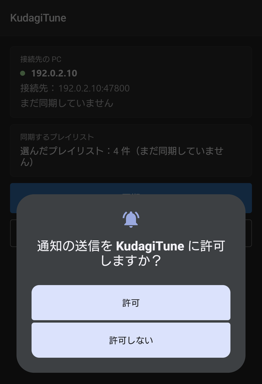
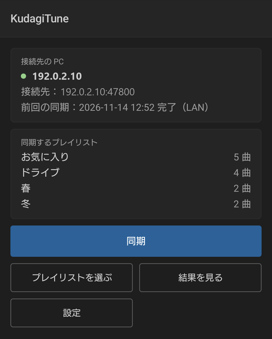
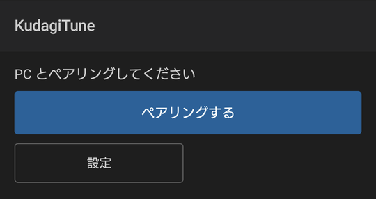
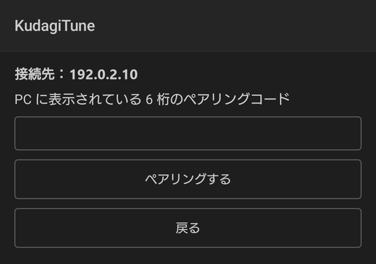
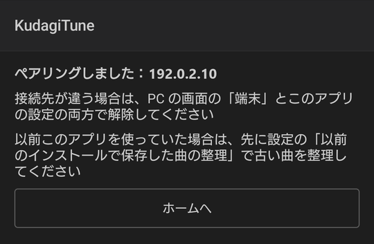
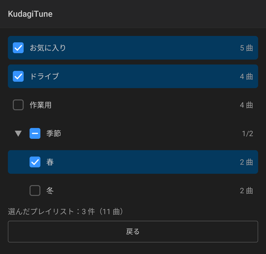
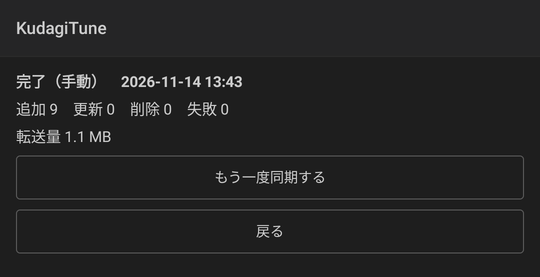
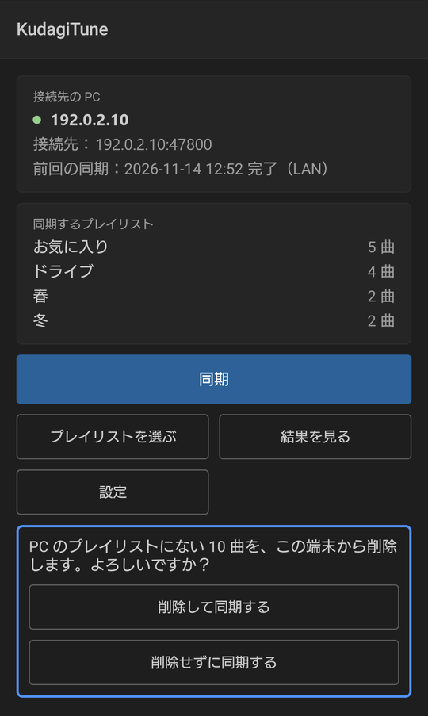
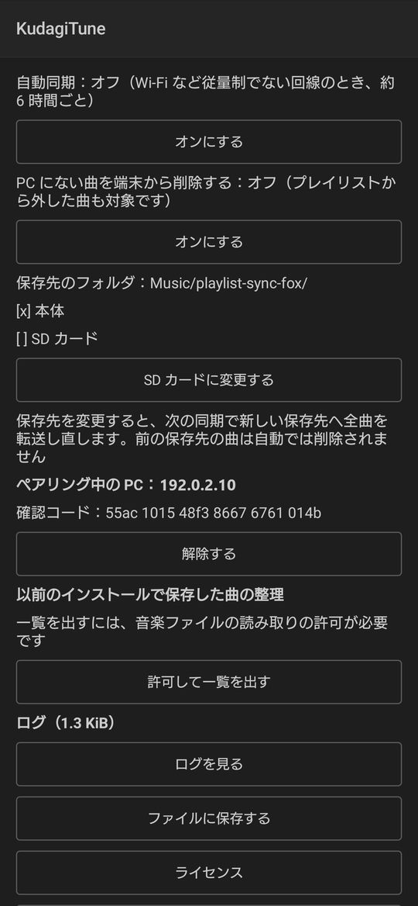

# KudagiTune 説明書（Android 版）

対象の版：KudagiTune 1.1.0

## できること

- PC の iTunes にあるプレイリストの曲を、Android 端末に取り込みます。
- PC がサーバーで、端末が取りに行きます。端末から PC に曲を送ることはありません。
- 同期は、手動で行う方法と、従量制でないネットワークにつながっている間に周期で起動する自動の方法があります。
- 同期するプレイリストは端末で選びます。PC の画面では選びません。選択は端末に保存されます。
- 曲は 1 曲ずつ転送します。途中で止まっても、続きから再開します。

この説明書は端末側の使い方です。PC 側は PC 版の説明書を見てください。

## 動作環境

- Android 11 以降
- PC 側は Windows の iTunes 12.x で、PC のアプリが起動していること（Apple Music アプリは未対応）
- 端末と PC が、同じ LAN、Tailscale、USB テザリング、Bluetooth テザリングのいずれかでつながること

## 導入

1. GitHub の Releases から APK をダウンロードします。
2. 端末で APK を開きます。「提供元不明のアプリ」のインストールを、使うブラウザやファイル管理アプリに許可する画面が出たら許可します。
3. インストールして起動します。
4. Android 13 以降では、ペアリング済みで手動の同期を始めるとき、通知の権限が許可されるまで、同期ボタンを押すたびに求められます（同じ起動の間は、拒否した後に再び求めません。ペアリングする操作と、同期するプレイリストが未選択のとき、保存先が無いとき、自動の同期が実行中で同期が始まらないときは求めません）。許可すると進み具合と結果が通知に出ます。拒否しても同期は動きます。二度拒否した後は、設定アプリで許可する案内が出ます。案内は、画面を移っても消えないメッセージ（トースト）で出ます。拒否している間は、設定の画面に「通知がオフになっています」と表示されます。

   

アプリ内では更新を確認しません。新しい版は GitHub の Releases で確認し、APK を上書きインストールしてください。

## 画面の構成

| 画面 | 内容 |
|---|---|
| ホーム | 最初に開く画面。接続先の PC の名前、接続先（前回つながった方式の宛先。まだつながっていなければ「未接続」）、前回の同期、同期するプレイリスト、同期ボタン |
| ペアリング | 初回の接続と、PC の確認 |
| 同期の進行状況 | 全体の進み具合、曲ごとの状態の一覧、ログの欄、「中断する」ボタン |
| 結果 | 前回の同期の結果と、同期しなかった曲・再生できない曲・失敗した曲の一覧 |
| プレイリストの選択 | PC のプレイリストの一覧から、同期するものを選ぶ |
| 設定 | 自動同期、PC にない曲の削除、保存先（本体か SD カード）、ペアリングの解除、以前のインストールで保存した曲の整理、ログ、ライセンス |

画面の配色は、端末のダークモードの設定に合わせて、ライトとダークが切り替わります。

アプリのアイコンは、同期の輪に狐の耳と尻尾を付けた図柄です（アダプティブアイコン。端末の形に合わせて切り抜かれます）。

## ペアリング

初回は PC とペアリングします。ペアリングの前は、ホームに「PC とペアリングしてください」とだけ出ます。

1. PC のアプリを起動し、PC の画面にペアリングコード（6 桁）を出しておきます。
2. 端末で「ペアリングする」を押します。ペアリングの画面が開きます。

   
3. PC を選びます。
   - 同じ LAN なら、PC が自動で一覧に出ます。一覧の PC の名前を選びます。
   - Tailscale の場合は、Tailscale のアプリで PC の名前（MagicDNS 名）を見て、「PC のアドレス」の欄に入力し、「接続する」を押します。PC の画面には MagicDNS 名は出ません。
   - USB テザリングの場合は、端末のテザリングを有効にします。PC が一覧に出ないときは、PC の画面に出ている IP アドレスを「PC のアドレス」の欄に入力し、「接続する」を押します（例：`192.0.2.10`）。
   - Bluetooth テザリングの場合は、端末と PC を Bluetooth でペアにしたうえで、端末の「Bluetooth テザリング」を有効にし、PC の Bluetooth の設定で端末のネットワーク（PAN）に参加します。あとは USB テザリングと同じです。転送は USB や Wi-Fi より大幅に遅く、自動の同期は通常は動きません（手動で同期してください）。PC がこの接続でインターネットに出ると端末のモバイル回線を使うため、ご注意ください。
4. PC に表示されている 6 桁の「ペアリングコード」を入力し、「ペアリングする」を押します。ペアリングコードは通信には流れません。

   
5. ペアリングが成功すると、「ペアリングしました」の画面に確認コード（PC の公開鍵のハッシュ）が出ます。後からは、設定の「ペアリング中の PC」で見られます。PC の画面の確認コードと見比べてかまいません。確認コードは表示だけで、押す操作はありません。違う場合は、PC の画面の「端末」とこのアプリの設定の両方で解除してから、もう一度ペアリングします。
6. 保存されると「ペアリングしました」と出ます。「ホームへ」でホームに戻ります。保存は、ペアリングが成功した時点で確定します。成功する前に画面を離れると、保存されません。
7. この端末に同期の記録がまだ無いときは、完了の画面に「以前このアプリを使っていた場合は、先に設定の「以前のインストールで保存した曲の整理」で古い曲を整理してください」と出ます。入れ直した端末では、先にその整理を行ってください。先に同期すると、全曲が `名前 (1)` の別名で置き直され、以前の曲と同じ容量がもう一度要ります。

   

### コードが通らないとき

- 入力を誤り続けると「入力できる回数を超えました」と出ます。PC でペアリングコードを作り直してください。
- 署名の失敗などで待ちの案内が出たときは、時間をおいてやり直してください。

### 端末を入れ直したあと

アプリを入れ直した端末は、PC に以前のペアリングが残っているため、新しく受け付けられません。
「この端末の登録が PC に残っています」という案内が出ます。
PC の画面の「端末」で「ペアリングを解除する」を押してから、もう一度ペアリングしてください。

## プレイリストの選択

同期するプレイリストは、端末の「プレイリストを選ぶ」の画面で選びます。ホームから開けます。

1. 画面を開くと、PC からプレイリストの一覧をもらいます（PC のアプリが起動していて、つながる必要があります）。
2. プレイリストの行を押すと、チェックが付いて選ばれます。行に色が付きます。もう一度押すと外れます。変更はすぐ保存されます。
   - フォルダの行を押すと、中のプレイリストをまとめて選びます。全部選んでいるときに押すと、まとめて外れます。フォルダ自体は保存されません。
   - 中の一部だけを選んでいるフォルダは、チェックが「―」になり、右に「選んだ数/全体の数」が出ます。押すと残りも選びます。
   - 行の頭の ▼／▶ で、フォルダを開いたり閉じたりします。
   - 一覧の下に、選んだプレイリストの件数と曲数の合計が出ます。

   
3. 選んだプレイリストが PC の一覧から消えると、保存してあった名前で「PC に見つかりません」と出ます。同期の後は、ホームの「同期するプレイリスト」でも曲数の代わりに「PC に見つかりません」と出ます。「外す」で選択から除きます。自動では消えません。外したプレイリストの m3u8 は、次の同期で端末から消えます。
4. 選んでいないときは、ホームの「同期するプレイリスト」に「同期するプレイリストを選んでください」と出ます。同期ボタンを押しても同期は始まらず、この画面へ案内されます。ただし、このアプリが書いたプレイリスト（m3u8）が端末に残っているときは同期が始まり、残ったプレイリストを消します。
5. 一覧を取得できないときは、同期と同じ案内が出ます。時計のずれ、通信の重複、一時的な拒否のときは、その理由が出ます（ペアリングのやり直しは要りません）。鍵が合わないときだけ、ペアリングのやり直しの案内が出ます。選んだプレイリストは変わりません。
6. 同期中に変えた選択は、次の同期から有効です。

## 同期

### 手動の同期

1. ホームで「同期」を押します。
2. 同期の進行状況の画面が開きます。
3. 終わると、自動で結果の画面に移ります。

   

PC に届かないとき、鍵が合わないとき、PC が XML を読めないときも、結果の画面に移り、失敗と出ます。PC と端末のアプリの版が合わないときは、結果に「PC と端末のアプリの版を合わせてください」と出ます。想定外のエラーで止まったときも、結果の画面に失敗と出て、理由はログに残ります。通知の権限を許可していれば、終わりの通知も出ます。

PC の曲とプレイリストを最後に取得できた同期が完了で、PC の曲とプレイリストがそれと同じときは、手動でも m3u8 は作り直さず、結果は変更なしの完了になります。端末で m3u8 を消していても、この場合は戻りません。

同期中にホームへ戻ると、同期ボタンが「進行状況を見る」に変わります。

自動の同期の実行中に同期ボタンを押したときは、確認を出さずに、その自動の同期の進行状況の画面が開きます。自動の同期は自動のまま進みます。確認が要る場合に消す処理を飛ばす扱いも、変化がなければ何もせず終わる扱いも、そのままです。終わった後に必要なら、もう一度同期ボタンを押してください。

進行状況の画面には、上から次が出ます。

- 段階の見出し（「PC に接続しています」「曲の一覧を取得しています」「変更点を確認しています」「空き容量を確認しています」「曲を転送しています」「プレイリストを保存しています」）と、全体の割合の棒。棒の下に、件数（完了／全体）、失敗の件数、容量（転送済み／全体）
- 時間の上限が近いときの注記、空き容量が足りないときの案内
- 曲ごとの一覧。転送する曲が 1 行ずつ並び、印で状態が分かります

| 印 | 状態 |
|---|---|
| チェック | 完了。曲名は薄い文字になります |
| 下向きの矢印 | 転送中。行に色が付き、曲名の下に棒が出ます。右に受け取った量と大きさが出ます |
| 時計 | 待機中 |
| × | 失敗。曲名の下に理由が出ます |

- ログの欄。アプリのログの新しい行が下に流れます（設定の「ログを見る」と同じ内容です。アプリを起動してからの分だけ出ます）

「中断する」を押すと同期を止めて、結果の画面に移ります。中断したときに転送中だった曲は、次の同期で続きから取ります。

### 自動の同期

- 設定で自動の同期を有効にすると、従量制でないネットワークにつながっている間、周期（6 時間）で起動します。つながった瞬間に始まるわけではありません。
- PC に届かないときは、何もしません。
- 確認が要る「消す」は、自動の同期では行わず、通知で知らせます。消す処理は手動の同期で行います。確認が要らない「消す」は、自動の同期でも行われます。確認が要る場合は、「消す曲が多いとき」「同期した曲の全部が消す対象になるとき」「別の PC やライブラリにつなぎ替えたとき」「PC で見つからないプレイリストがあり、消す曲もあるとき」です。
- 次のときは、自動の同期は何もせず終わります。手動の同期が完了または一部失敗で終わった後の 30 分間（失敗した手動の同期の後は止まりません）。前回の同期で鍵が合わなかったとき（再ペアリングまで。時計のずれは含みません）。前回が容量不足だったとき（手動の同期が成功するまで）。PC の曲とプレイリストを最後に取得できた同期が完了で、PC の曲とプレイリストがそれと同じとき（取得せずに終わり、m3u8 も作り直しません）。
- 自動の同期が失敗して結果が残ったときは、通知で知らせます（鍵が合わない、時計が違う、PC が XML を読めない、など）。再ペアリングが要るのは鍵が合わないときだけです。PC に届かないときは通知しません。
- モバイル回線の Tailscale では起動しません。外出先では手動で同期してください。
- 自動の同期の通知は、通知の権限を許可しているときだけ出ます。

### 中断と続き

- 通信が切れたり中断したりしても、置き終えた曲は残り、次の同期で続きから進みます。
- PC が曲を途中までしか返さなかったとき（正常に終わったのに足りないとき）も、切れた場合と同じに続きから取り直します。取り直しても 1 バイトも増えないときは、その曲を「失敗した曲」にして、次の曲へ進みます。
- 「中断する」で止めたときは、原因は出ません。その前に失敗した曲があれば、失敗の件数と一覧に残ります。
- 中断で止まったときは、プレイリスト（m3u8）の書き直しが間に合わず、次の同期に回ることがあります。
- 途中の曲が PC で変わった場合は、再度同期してください。

### 1 日 6 時間の上限

Android 15 以降は、バックグラウンドの転送に 1 日に合計 6 時間の上限があります。
長い初回の同期は、数回に分かれることがあります。
上限が近いと、進行状況の画面に注記が出ます。
アプリを前面に出すと計時が戻ります。続きは次の同期で行われます。

## 結果の見方

結果の画面には、前回の同期の次の項目が出ます。

| 項目 | 内容 |
|---|---|
| 結果の区分 | 完了、一部失敗、中断、失敗、開始できず のいずれかと、手動か自動か。容量不足で始められなかった同期は「開始できず」と出ます（PC の画面には「失敗」と出ます） |
| 件数 | 追加、更新、削除、失敗の数 |
| 転送量 | 転送した容量 |
| 原因 | 失敗したときだけ出ます。ペアリングの問題のときは、時計のずれ、通信の重複、一時的な拒否、証明書の変更、署名の不一致のうち、どれが理由かが出ます（再ペアリングが要るのは、証明書の変更と署名の不一致だけです）。PC と端末のアプリの版が合わないときは「PC と端末のアプリの版を合わせてください」と出ます |
| 削除しなかった曲 | 「PC にない曲を端末から削除する」がオフのときなどに、削除しなかった件数 |

「同期しなかった曲」の一覧には曲名・アーティスト・理由が、「再生できない曲」の一覧には曲名・形式・理由が、「失敗した曲」の一覧には曲名とエラーの番号が出ます。件数が多いときは「ほか N 件」と出ます。

| 一覧 | 意味 |
|---|---|
| 同期しなかった曲 | PC 側でファイルが無い、読めない、場所が分からないなどの理由で、転送しなかった曲 |
| 再生できない曲 | 著作権保護された曲（.m4p）です。転送しません。ALAC や AIFF などは転送します。再生できるかどうかは、お使いのプレイヤーによって違います |
| 失敗した曲 | 転送や保存に失敗した曲 |

- 「もう一度同期する」で、続けて同期できます。
- 「過去の同期」から選んで、その結果を見ることもできます。
- 同期の実行中は、ホームと結果の「前回の同期」に、その同期は出ません（前の同期が出ます。前の同期が無いときは「まだ同期していません」と出ます）。アプリが途中で終了して終わりが記録されなかった同期は「中断」と出ます。
- 自動の同期で削除を飛ばしたときは、結果に「削除が必要な曲があります。手動で同期すると、確認のうえ削除します」と出ます。手動の同期で確認を済ませずに削除を飛ばしたときは「削除の確認が済んでいないため、削除しませんでした。もう一度同期すると確認が出ます」と出ます。

## プレイリストと曲の置き場

| 種類 | 置き場 |
|---|---|
| 曲 | `Music/playlist-sync-fox/<アーティスト>/<アルバム>/` |
| プレイリスト（m3u8） | `Music/playlist-sync-fox/` の直下に、プレイリストごと |

- フォルダ名は、アプリの名前を KudagiTune に改める前の名前のままです。アプリの名前を変えても、保存先のフォルダ名は変わりません。
- アーティストは、アルバムアーティストがあればそれを使い、なければアーティストを使います。どちらも空なら `Unknown Artist` です。アルバムが空なら `Unknown Album`、曲名が空なら `Untitled` です。
- ファイル名に使えない文字は `_` に置き換わります。
- 一度置いた曲は、曲名やアーティストを PC で変えても動きません。
- 保存先は、設定で本体か SD を選べます（既定は本体。下の「保存先の切り替え」）。
- 端末のプレイヤーは、Android の MediaStore の索引で曲を見ます。プレイヤーでの見え方は、アプリごとに違う可能性があります。

## 保存先の切り替え

- 設定の保存先で「本体に変更する」「SD カードに変更する」を押して切り替えます。全体で 1 つだけ選びます。
- 切り替えた後の最初の同期で、すべての曲とプレイリストを新しい場所へ取り直します。前の場所の曲とプレイリストは、自動では消えません。残っている件数が設定に「前の保存先に残っている曲とプレイリスト」として出るので、「前の保存先の曲を削除する」を押して、確認の後に削除します（このアプリが置いたものだけ。同期中はボタンの代わりに「同期中は削除できません」と出ます）。途中で失敗したり止まったりしたときも、前の場所のものは残り、次の同期が続けます。
- 切り替えたときに前の場所の曲が残っていると、「前の場所に曲が残っています。次の同期の前に、「前の保存先の曲を削除する」で、先に前の場所の曲を消してください」という案内が付きます（切り替え自体は止まりません）。残したまま本体と SD カードの間を戻して同期すると、前の場所の曲と名前が重なり、全曲が `名前 (1)` の別名で重複して置かれるためです。
- 空き容量は、新しい場所で確かめます。
- 保存先を SD にしていて SD が見つからないときは、同期を始めず案内が出ます。自動で本体に切り替えることはありません。SD カードを入れ直すか、設定で保存先を変更してください。

## 消える曲と消えない曲

- 消えるのは、このアプリが置いた曲だけです。ほかの曲には触りません。
- 設定「PC にない曲を端末から削除する」がオンのとき、PC のプレイリストにない曲（端末で選択から外したプレイリストにしか入っていない曲を含む）は、同期で削除されます（既定のオフでは削除されません）。手動の同期では、削除する曲が 1 件でもあれば先に確認が出ます。自動の同期では、確認が要る場合は消さず、通知で知らせます。確認が要らない場合は、自動の同期でも消えます。
- 次のいずれかのときに、確認が要る扱いになります。消す曲が多いとき。同期した曲の全部が消す対象になるとき。別の PC や別のライブラリにつなぎ替えたとき（曲の追加や削除ではありません）。消す曲があり、PC に見つからないプレイリストが 1 件でもあるとき。
- 手動の同期では、確認で削除する件数を見て、「削除して同期する」か「削除せずに同期する」を選びます。「削除せずに同期する」を選ぶと、削除だけを飛ばして同期します。

  
- 確認で承認した件数を超えて消す必要が出たときは、消す処理を飛ばします。
- アプリを入れ直すと、以前に置いた曲と m3u8 は「このアプリが置いたもの」と扱われません。消えずに残ります。入れ直した後の最初の同期では、同じ場所に置き直すため、曲は `名前 (1)` のように重複し、m3u8 も `名前 (1).m3u8` の別名で新しく作られます。前の m3u8 は残ります。重複を避けるには、同期の前に設定の「以前のインストールで保存した曲の整理」を使います。同期の後でも、整理で以前の曲と m3u8 を消せます。

## 設定

| 項目 | 内容 |
|---|---|
| 自動同期 | 「オンにする」「オフにする」で自動の同期を切り替えます。条件は、従量制でないネットワークにつながっている間、周期で起動することです。PC に届かなければ何もしません |
| PC にない曲を端末から削除する | 「オンにする」「オフにする」で切り替えます。既定はオフです。オフのときは、PC のプレイリストにない曲（プレイリストから外した曲も含む）があっても端末から削除せず、確認も出ません。結果の画面に「削除しなかった曲」の件数が出ます。オンにすると、上の「消える曲と消えない曲」のとおりになります |
| 保存先 | 本体か SD カードを選びます（既定は本体）。「保存先のフォルダ」に `Music/playlist-sync-fox/` が表示されます。選んだ SD カードが見つからないときは「SD カード（見つかりません）」と出ます |
| ペアリング中の PC | PC の名前と確認コードが出ます。「解除する」で、端末の鍵とペアリングの情報を消します。確認が出ます |
| 以前のインストールで保存した曲の整理 | 入れ直した後に、このアプリが置いたと分からない曲と、前の m3u8 の数が出ます（持ち主を問わず、保存先の下にある曲を調べます）。権限が無いときは「許可して一覧を出す」を押すと、読み取りの権限を求めます。許可すると一覧が出るので、選んで削除します |
| ログ | ログの大きさが出ます。「ログを見る」で、表示、共有、消去ができます。ログは常に記録され、オフにする設定はありません。共有は、新しい分から一定の行数（最近の分）までに切って、共有の画面へ渡します。設定の「ファイルに保存する」は、保存先を選んで、ログ全体（古い分から全部）を .txt のファイル（名前の例は `kudagitune-log-20261109-153045.txt`）に書き出します。曲名が含まれるため、共有と保存の前に「ログには曲名が含まれます」の確認が出ます |
| ライセンス | 使っているオープンソースの一覧と、項目を選ぶとそのライセンスの全文を表示します。部品が NOTICE を持つときは、全文と一緒に出ます。URL を押すとブラウザで開きます。文字を長押しすると、選んでコピーできます |

### 以前の曲の整理

1. 設定の「以前のインストールで保存した曲の整理」を見ます。
2. 「許可して一覧を出す」を押し、音声の読み取りの権限を許可します。この権限は、ここを使うときだけ求められます。
3. 一覧から削除する曲を選び、「選んだ曲を削除する（確認の画面が出ます）」を押します。
4. Android の同意の画面が出たら、内容を確認して許可します。

### ペアリングの解除

端末側の解除は、端末の鍵とペアリングの情報を消します。
PC 側にも、端末のペアリングが残ります。PC の画面の「端末」でも「ペアリングを解除する」を押してください。

## データの扱い

- 端末の設定や鍵は、アプリの内部領域に保存されます。アプリを削除すると消えます。
- 曲と m3u8 は `Music/` に残ります。アプリを削除しても自動では消えません。
- 通信は、PC の自己署名の証明書で暗号化されます。ペアリングしていない端末には、同じ LAN の中でも曲を渡しません。
- ログに、鍵とコードは出ません。曲のパスは、PC のログにも出ません（出るのは曲の表示名と大きさだけです）。

## 困ったとき

| 表示や状況 | 原因と対処 |
|---|---|
| PC に届かない | 端末と PC が同じネットワークか、PC のアプリが起動しているかを確かめます。Tailscale の場合は、入力した名前が、Tailscale のアプリで見える PC の名前と合っているかを確かめます |
| PC が見つからない | 「PC のアドレス」の欄に、Tailscale のアプリで見える PC の名前か、PC の画面に出ている IP アドレスを入力します |
| ペアリングのやり直しが必要 | 鍵が合っていません。PC の画面の「端末」で「ペアリングを解除する」を押し、端末の設定でも解除してから、再度ペアリングします |
| 証明書が変わった | PC の鍵が作り直されました。PC で端末のペアリングを解除し、端末の設定でも解除してから、再度ペアリングします。それまで自動の同期は止まります |
| 容量不足 | 不足分が出ます。端末の空きを作り、再度同期します。「ストレージの設定を開く」で空きを作る画面を開けます |
| PC の XML が読めない | PC の iTunes の設定で「iTunes ライブラリ XML をほかのアプリケーションと共有」（英語版では「Share iTunes Library XML with other applications」）の項目が有効か確かめます。PC 側の説明書を見てください。PC を再起動した直後にも出ます。その場合は、もう一度同期します |
| ファイルが無い | iCloud から未ダウンロードの曲などです。結果の一覧で曲を確かめます |
| 途中で切れた | 再度同期します。続きから進みます。PC が途中までしか返さなかったときも同じです。取り直しても増えない曲は「失敗した曲」に出て、次の曲へ進みます |
| 時間の上限 | 次の同期で続きます |
| 曲が変わった | 転送中に PC で曲が変わりました。再度同期します |
| 保存に失敗 | 端末の空きや権限を確かめ、再度同期します |
| 再生できない曲がある | 結果の「再生できない曲」の一覧を見ます。著作権保護された曲（.m4p）は転送されません |
| PC と端末のアプリの版を合わせてください | PC のアプリと端末のアプリの版が合っていません。新しい版を、PC と端末の両方に入れてから、もう一度同期します |
| 保存先を戻したら曲が重複した | 前の保存先に曲が残ったまま同期すると、全曲が `名前 (1)` の別名で重複して置かれます。保存先を切り替えたときの案内のとおり、同期の前に設定の「前の保存先の曲を削除する」で前の場所の曲を消します |
| 端末と PC の時計が違う | 端末か PC の時計を合わせます。数分以上ずれると、署名が通りません。結果には時計が違うと出ます。再ペアリングは要りません。端末の時刻が PC の起動時刻より前のときも、ずれが小さくても通りません |
| PC が一時的に断った | 要求が続いたため、PC が一時的に断りました。時間をおいてから同期します |
| 通知が出ない | Android 13 以降は、通知の権限を許可します。二度拒否した後は、設定アプリで許可します。拒否しても同期は動きます |
| 自動の同期が始まらない | 周期（6 時間）がまだ来ていない、手動の同期が完了または一部失敗で終わった後の 30 分間、前回の鍵の不一致（再ペアリングまで）や容量不足（手動の同期の成功まで）で止まっている、PC の曲とプレイリストを最後に取得できた同期が完了で PC の曲とプレイリストがそれと同じ、のいずれかです。モバイル回線の Tailscale では起動しません |

ほかの原因は、同期の進行状況の画面のログの欄か、設定の「ログを見る」で調べてください。共有もできます。
